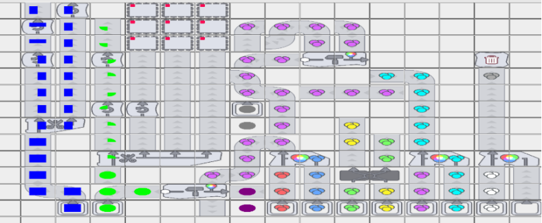
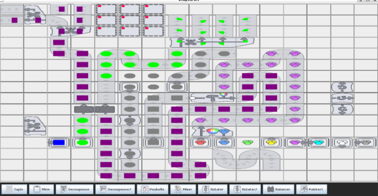

<div align="center">

# ShapeCraft

**Clone en Java du jeu de logistique Shapez.io : extraire, transformer et assembler des formes et des couleurs**


[Installation](#mise-en-place) · [Machines](#machines-impl%C3%A9ment%C3%A9es) · [Signaler un bug](../../issues)



</div>

---

## Le projet

ShapeCraft reprend le principe de [Shapez.io](https://github.com/tobspr-games/shapez.io) : on place des machines sur une grille et on les relie par des tapis roulants pour fabriquer les formes demandées par le Hub. Les objectifs se corsent de niveau en niveau.

Projet universitaire réalisé en binôme dans le cadre de l'UE LIFPOO (2025-2026).

---

## Stack technique

| | |
|---|---|
| **Langage** | Java |
| **Interface** | Swing (grille de 16 × 16 cases, barre de machines en bas de fenêtre) |
| **Architecture** | Modèle / Vue-Contrôleur, avec le patron Observateur pour rafraîchir la vue |
| **Concurrence** | Chaque machine tourne dans son propre thread, selon un schéma maître / esclave (`Machine` et ses `Worker`) |
| **Outils** | IntelliJ IDEA, GitLab CI/CD |

__*Pourquoi cette architecture ?*__

Séparer le modèle (plateau, machines, items) de la vue permet de faire évoluer l'interface sans toucher à la logique du jeu. Les machines travaillent en parallèle, comme dans le jeu original : chacune traite ses items à son rythme et les passe à la suivante.

---

## Fonctionnalités

- Placer et orienter des machines sur la grille (clic, glisser pour poser une ligne de tapis, touche `R` pour tourner)
- Des gisements de formes et de couleurs exploités par des mines
- Un Hub qui valide des objectifs, avec 4 niveaux de difficulté croissante
- Formes composées de quarts de cercle, que l'on peut découper, faire pivoter et colorer

### Machines implémentées

| Machine | Fonction |
|:---|:---|
| Mine | Extraction de formes / couleurs |
| Tapis roulant | Transport d'items |
| Rotater | Rotation horaire / antihoraire |
| Découpeuse | Simple (×2) ou Quad (×4) |
| Balancer | Croisement de flux |
| Mixer | Mélange de couleurs |
| Painter | Coloration de formes |
| Hub | Validation des objectifs |
| Poubelle | Destruction d'items |

---

## Mise en place

Il vous faut un JDK récent (le projet est configuré avec OpenJDK 26 dans IntelliJ).

```bash
git clone https://github.com/farahbouh/Shapez.io.git
```

**Avec IntelliJ IDEA :**

1. Ouvrez le dossier du projet (la racine du dépôt).
2. Ouvrez la classe `src/Main.java`.
3. Cliquez sur **Run** (ou `Shift + F10`) : le jeu s'ouvre dans une nouvelle fenêtre.

**En ligne de commande (Linux / macOS) :**

```bash
cd Shapez.io
javac -d out $(find src -name '*.java') && cp -r src/data out/
java -cp out Main
```

Les sprites sont embarqués dans le projet (`src/data`) : le jeu se lance depuis n'importe quel dossier.

<details>
<summary>Structure du projet</summary>

```bash
Shapez.io
├── images                 # captures d'écran du README
└── src
    ├── Main.java
    ├── data
    │   └── sprites        # images des machines et des items
    ├── modele
    │   ├── item           # formes et couleurs
    │   ├── jeu            # boucle de jeu
    │   └── plateau        # grille, machines, niveaux, Hub
    └── vuecontroleur      # interface Swing
```

</details>

<details>
<summary>Un problème au lancement ?</summary>

- **Les fichiers `.java` ont une icône de tasse** : clic droit sur le dossier `src` > *Mark Directory as* > *Sources Root*.
- **Version de Java** : si IntelliJ signale un JDK introuvable, choisissez-en un autre dans *File -> Project Structure -> SDK*.

</details>

---

## Ce que ce projet m'a appris

- Appliquer l'architecture Modèle / Vue-Contrôleur et le patron Observateur sur un vrai projet
- Faire travailler plusieurs machines en parallèle avec des threads
- Modéliser des objets métier en programmation orientée objet (machines, items, plateau, niveaux)
- Travailler à deux sur un même code avec Git et GitLab

---

## Crédits

Projet inspiré de [Shapez.io](https://github.com/tobspr-games/shapez.io) de tobspr Games, dont sont issus les sprites.

---

<div align="center">

Réalisé par [Farah](https://github.com/farahbouh) et [Stan](https://github.com/Stan-dev69)

Contact : [LinkedIn](https://www.linkedin.com/in/farahbouh) · [Email](mailto:farah.bouhnaida@gmail.com)

</div>